<!--
SizWinz portfolio · connected project cards with individual links.
Graphics adapted from HANCORE's MIT-licensed assets. See LICENSE-HANCORE.
Project covers use original branding and generated artwork based on repository details.
Rebuild: python scripts/build.py && python scripts/build_art_assets.py && python scripts/build_composed.py && python scripts/build_cards.py && python scripts/build_stats.py && python scripts/build_profile_extras.py && python scripts/build_wakatime.py
Regenerate README: python scripts/make_readme.py
-->

  <picture>
    <source media="(prefers-color-scheme: dark)" srcset="./assets/sahaj-signature-dark.svg" />
    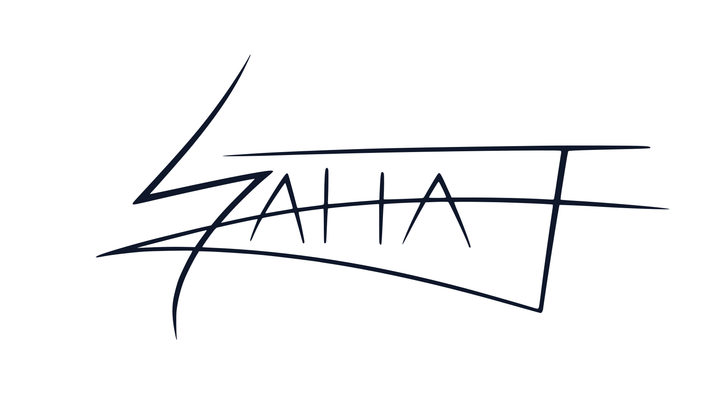
  </picture>

  <picture>
    <source media="(min-width: 1280px) and (prefers-color-scheme: dark)" srcset="./assets/bio-wide-dark.png" width="744" height="76" />
    <source media="(min-width: 1280px) and (prefers-color-scheme: light)" srcset="./assets/bio-wide-light.png" width="744" height="76" />
    <source media="(prefers-color-scheme: dark)" srcset="./assets/bio-narrow-dark.png" />
    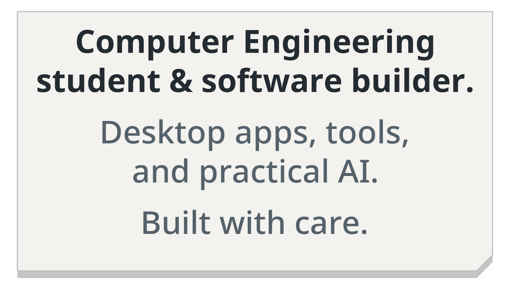
  </picture>

  <picture>
    <source media="(prefers-color-scheme: dark)" srcset="./assets/label-main-dark.png" />
    
  </picture>

<a href="https://github.com/PocketMC/pocket-mc-windows" title="PocketMC"><picture><source media="(prefers-color-scheme: dark)" srcset="./assets/card-pocketmc-hq-dark.svg" />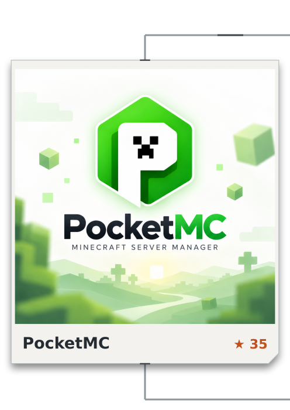</picture></a><a href="https://github.com/sizwinz/MSM-minecraft-server-manager-termux" title="MSM"><picture><source media="(prefers-color-scheme: dark)" srcset="./assets/card-msm-hq-dark.svg" /></picture></a><a href="https://github.com/sizwinz/StudySage-Offline-Online-AI-Note-Assistant" title="StudySage"><picture><source media="(prefers-color-scheme: dark)" srcset="./assets/card-studysage-hq-dark.svg" /></picture></a> 
<a href="https://github.com/DS-labs-33" title="DS Labs"><picture><source media="(prefers-color-scheme: dark)" srcset="./assets/card-ds-labs-dark.svg" /></picture></a>

  <picture>
    <source media="(prefers-color-scheme: dark)" srcset="./assets/label-gallery-dark.png" />
    
  </picture>

<a href="https://github.com/sizwinz/GitFetch" title="GitFetch"><picture><source media="(prefers-color-scheme: dark)" srcset="./assets/card-gitfetch-hq-dark.svg" /></picture></a><a href="https://github.com/sizwinz/SkillWise" title="SkillWise"><picture><source media="(prefers-color-scheme: dark)" srcset="./assets/card-skillwise-hq-dark.svg" />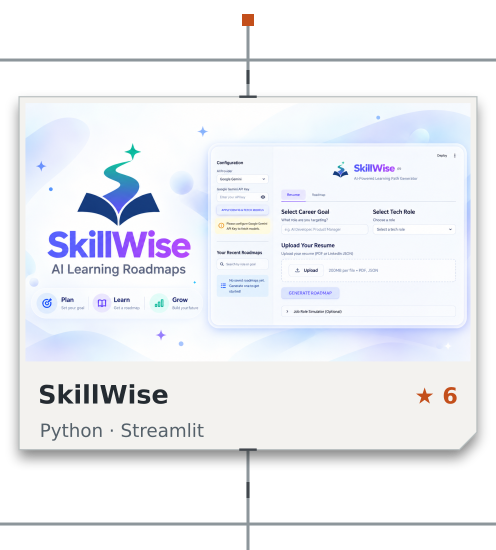</picture></a><a href="https://github.com/sizwinz/ServerPulse" title="ServerPulse"><picture><source media="(prefers-color-scheme: dark)" srcset="./assets/card-serverpulse-hq-dark.svg" />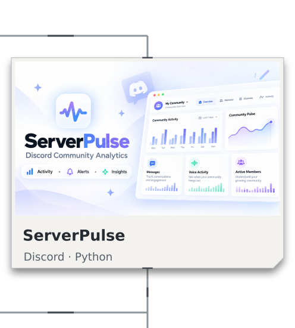</picture></a> 
<a href="https://github.com/sizwinz/WatchMark" title="WatchMark"><picture><source media="(prefers-color-scheme: dark)" srcset="./assets/card-watchmark-dark.svg" />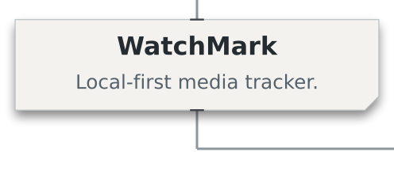</picture></a><a href="https://github.com/DS-Labs-33/Campus-Assistant" title="Campus Assistant"><picture><source media="(prefers-color-scheme: dark)" srcset="./assets/card-campus-dark.svg" /></picture></a><a href="https://github.com/PocketMC/pocket-mc-linux-mac" title="PocketMC on Linux"><picture><source media="(prefers-color-scheme: dark)" srcset="./assets/card-pocketmc-linux-dark.svg" />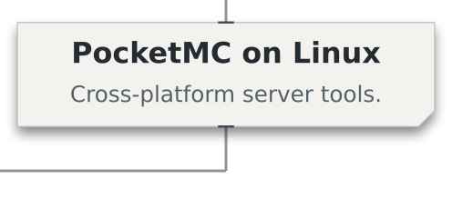</picture></a> 
<a href="https://github.com/sizwinz?tab=repositories" title="More repositories"><picture><source media="(prefers-color-scheme: dark)" srcset="./assets/card-repositories-dark.svg" /></picture></a>

  <picture>
    <source media="(prefers-color-scheme: dark)" srcset="./assets/label-hackathons-dark.svg" />
    
  </picture>

<a href="https://github.com/sizwinz/SchemeSetu" title="SchemeSetu"><picture><source media="(prefers-color-scheme: dark)" srcset="./assets/card-schemesetu-hq-dark.svg" />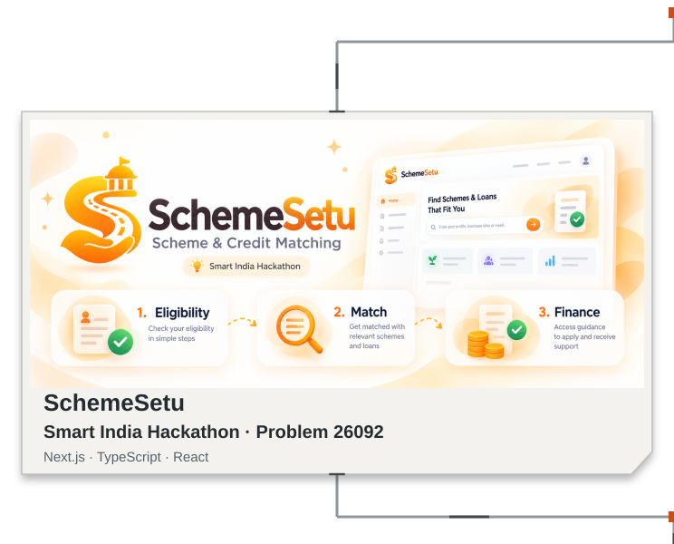</picture></a><a href="https://github.com/sizwinz/EcoSpot" title="EcoSpot"><picture><source media="(prefers-color-scheme: dark)" srcset="./assets/card-ecospot-hq-dark.svg" />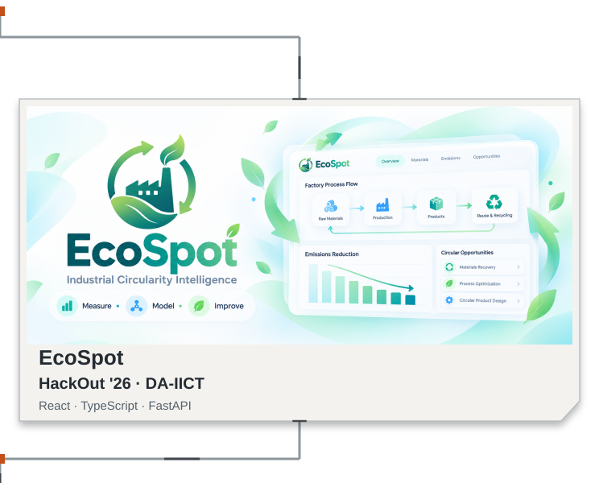</picture></a> 
<picture><source media="(prefers-color-scheme: dark)" srcset="./assets/card-closing-dark.svg" /></picture>

  <a href="https://github.com/sizwinz" title="GitHub statistics"><picture><source media="(prefers-color-scheme: dark)" srcset="./assets/github-stats-dark.svg" />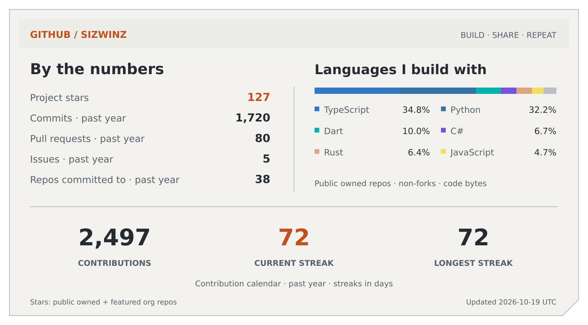</picture></a>

  <a href="https://wakatime.com/@sizwinz" title="WakaTime all-time tracked time"><picture><source media="(prefers-color-scheme: dark)" srcset="./assets/wakatime-dark.svg" /></picture></a>

  <a href="https://sahaj33.me" title="sahaj33.me"><picture><source media="(prefers-color-scheme: dark)" srcset="./assets/link-website-dark.svg" /></picture></a><a href="https://github.com/PocketMC" title="PocketMC"><picture><source media="(prefers-color-scheme: dark)" srcset="./assets/link-pocketmc-dark.svg" />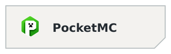</picture></a><a href="https://github.com/DS-labs-33" title="DS Labs"><picture><source media="(prefers-color-scheme: dark)" srcset="./assets/link-dslabs-dark.svg" />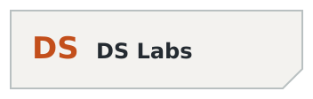</picture></a>

  <a href="https://discord.com/users/775329619259162654" title="Discord"><picture><source media="(prefers-color-scheme: dark)" srcset="./assets/social-discord-dark.png" /></picture></a>
  <a href="https://www.buymeacoffee.com/sahaj33" title="Buy Me a Coffee"><picture><source media="(prefers-color-scheme: dark)" srcset="./assets/social-coffee-dark.svg" /></picture></a>
  <a href="./ASSET-CREDITS.md" title="Artwork credits and licenses"><picture><source media="(prefers-color-scheme: dark)" srcset="./assets/social-acknowledgements-dark.png" /></picture></a>

About me

I am a Computer Engineering student from Surat, India. Driven by curiosity, discipline, and first-principles thinking, I make practical AI systems, desktop applications, and developer tools that solve real problems.

As the leader of **DS Labs**, I turn ideas from a blank page into production-quality software. I focus on creating genuine utility for real people rather than chasing trends, making software that others can use without hassle.

Beyond writing code, I am deeply interested in human psychology, product design, gaming, and entrepreneurship. I prefer creating over consuming and believe that meaningful progress comes from consistency, small experiments, and independent thinking. In the long term, I want to create products that reach millions of people while building businesses with lasting impact.

<picture><source media="(prefers-color-scheme: dark)" srcset="./assets/tech-stack-grid-dark.svg" />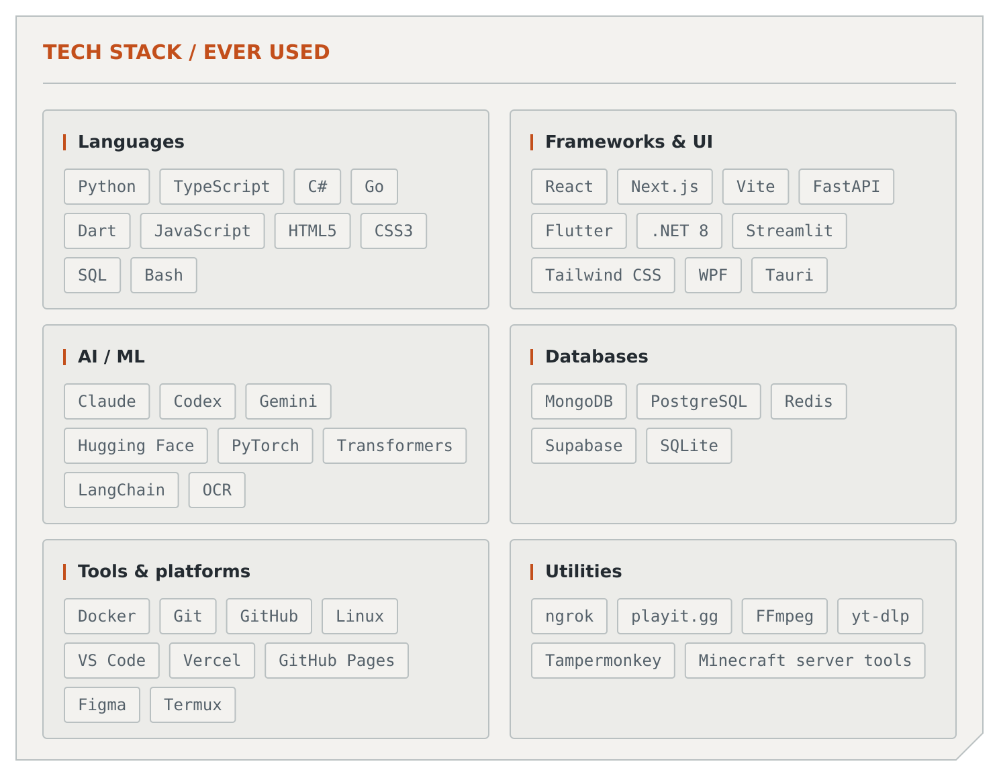</picture>

**Quotes I live by**

| Quote | Author |
| --- | --- |
| Become an expert in one thing and then build multiple income streams out of that one thing. | Raj Shamani |
| Give people wonderful tools and they'll do wonderful things. | Apple |
| Ever tried? Ever failed? No matter. Try again. Fail again. Fail better. | Samuel Beckett |
| I think it's very important to have a feedback loop, where you're constantly thinking about what you've done and how you could be doing it better. | Elon Musk |

